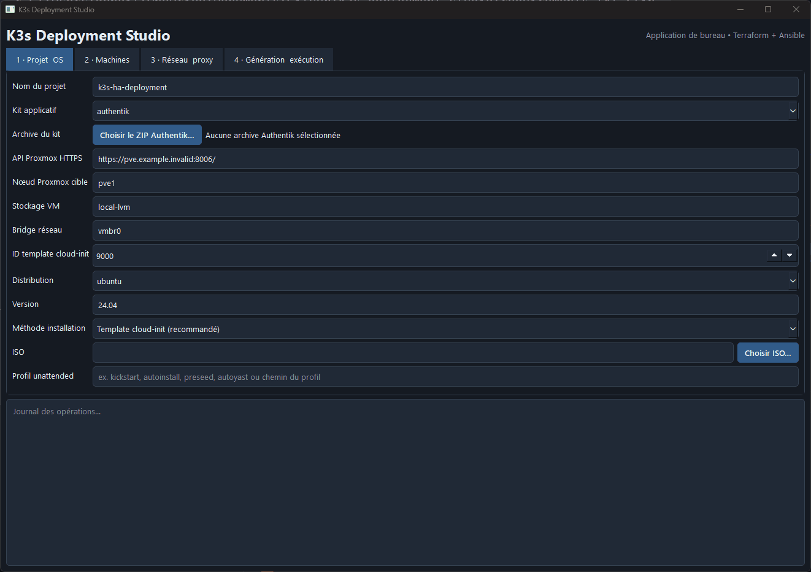

# K3s Deployment Studio

Application de bureau native (PySide6) pour préparer et orchestrer le déploiement initial de clusters K3s HA sur Proxmox VE avec Terraform et Ansible.
<!-- License badge: place this near the top of the README -->
[](LICENSE)

<!-- License section: place this near the end of the README -->
## License

K3s Deployment Studio is licensed under the [Apache License, Version 2.0](LICENSE).

Copyright © 2026 sudobenz.

Unless otherwise stated, this license applies to the original project files authored for this repository. Third-party components and assets remain subject to their respective licenses and notices.

## Demo



## Fonctionnalités du MVP

- Interface desktop native, sans serveur Web ni navigateur intégré.
- Choix du kit cible : Authentik HA ou Keycloak HA.
- Sélection d'une archive ZIP de kit depuis n'importe quel emplacement du poste, sans nom de fichier imposé.
- Contrôle du type de kit à partir des scripts contenus dans l'archive ; les archives Authentik et Keycloak ne peuvent pas être interverties.
- Conservation de l'archive sélectionnée comme source indépendante et copie dans le workspace généré.
- Nombre de machines modifiable par l'utilisateur (1 à 20), ajout/suppression de lignes et configuration individuelle : nom, IPv4/CIDR, passerelle, DNS, vCPU, RAM, disque système et disque données.
- Catalogue OS (Ubuntu, Debian, Rocky, AlmaLinux, RHEL, SUSE) et sélection d'ISO personnalisée.
- Profil d'installation requis pour une ISO personnalisée : autoinstall, preseed, kickstart, autoyast ou profil fourni par l'utilisateur. Le MVP bloque l'exécution si le profil requis n'est pas défini.
- Proxy HTTP/HTTPS/NO_PROXY, CA d'entreprise optionnelle.
- Génération de fichiers Terraform, inventaire Ansible, playbooks de préparation OS, variables proxy et manifeste de déploiement.
- Exécution locale de `terraform init`, `terraform validate`, `terraform plan` et `terraform apply` (apply demande une confirmation explicite).
- Exécution Ansible distincte, après disponibilité SSH des machines.
- Validation des IP dupliquées, hostnames, tailles, passerelle, DNS et chemins.

## Sélection des kits Authentik et Keycloak

Aucune archive Authentik ou Keycloak n'est embarquée dans ce dépôt. Les deux kits sont distribués séparément.

Dans l'interface, sélectionner le type de kit (**authentik** ou **keycloak**), puis choisir son archive ZIP dans la fenêtre de sélection. Le fichier peut être situé où l'utilisateur le souhaite et son nom est libre. Lors du changement de type de kit, l'application demande une archive correspondante ; le bouton de sélection permet également de la remplacer manuellement.

L'application vérifie le contenu de l'archive avant de l'accepter. Pour Authentik, elle recherche les scripts `03-deploy-authentik.sh` et `15-upgrade-authentik.sh`. Pour Keycloak, elle recherche `08-deploy-keycloak.sh` et `16-upgrade-keycloak.sh`. Cette vérification évite de sélectionner par erreur le kit opposé et ne dépend pas du nom du ZIP.

À la génération, l'archive sélectionnée est copiée sans modification dans `imported-kit/` du workspace. Un manifeste `config/kit-handoff.json` conserve le type de kit et le nom de l'archive. **La génération ne lance pas automatiquement les scripts Authentik ou Keycloak** : les paramètres de l'environnement doivent être contrôlés avant leur exécution. Voir [`kits/README.md`](kits/README.md).

## Limites explicites de cette version

Cette version constitue un MVP exécutable de préparation et d'orchestration. Elle ne prétend pas encore installer sans intervention toute ISO arbitraire. Le backend Terraform Proxmox fourni utilise un modèle/template cloud-init préexistant (`template_vm_id`) ; l'ISO personnalisée est sélectionnée et enregistrée dans le profil, mais son installation unattended doit être fournie par un profil d'installation compatible et préparé sur Proxmox. Le workflow ISO brut (création automatique du média de réponse, boot order, console et détection de fin d'installation) reste à qualifier par distribution et version.

Le déploiement des kits Authentik/Keycloak n'est pas déclenché automatiquement dans le MVP : les archives sélectionnées sont préservées dans le workspace et un manifeste de handoff est généré. Il faudra valider les paramètres spécifiques du kit choisi avant d'appeler ses scripts.

Le disque OS utilise LVM avec le VG étendu au maximum et le LV root configuré à `100%FREE` dans les profils fournis. Le disque données est séparé et préparé en ext4 pour Longhorn ; il n'est jamais ajouté au VG système.

## Prérequis

- Python 3.11+
- PySide6, PyYAML
- Terraform 1.8+
- Ansible Core 2.16+ (Linux ou WSL2 sous Windows)
- Accès API Proxmox VE et template cloud-init Linux déjà préparé

## Installation

### Linux

```bash
python3 -m venv .venv
source .venv/bin/activate
pip install -r requirements.txt
python -m app.main
```

### Windows

Depuis PowerShell, lancer `Set-ExecutionPolicy -Scope Process Bypass` puis `\.\packaging\launch-windows.ps1`. Le lanceur détecte Python 3.11+ (`py`, `python` ou `python3`) et propose, si nécessaire, une installation utilisateur de Python 3.12 via winget. Il crée ensuite `.venv`, installe les dépendances et démarre l'application. Terraform doit être dans le PATH ; Ansible s'exécute dans WSL2. Voir `docs/WINDOWS.md`.

## Sécurité

- Le token Proxmox est saisi dans l'interface puis transmis au processus Terraform via `TF_VAR_proxmox_api_token`. Il n'est pas écrit dans les fichiers Terraform générés.
- Ne pas committer les fichiers `.tfstate`, `.tfvars`, `.env`, les secrets ni les archives de kits importées.
- TLS Proxmox est vérifié par défaut. `PM_TLS_INSECURE=1` n'est prévu que pour un laboratoire isolé et n'est pas exposé comme choix par défaut dans l'UI.
- `terraform apply` est séparé de `plan` et demande une confirmation.
- L'application ne détruit pas automatiquement les VM.

## Démarrage rapide

1. Lancer l'application.
2. Choisir **authentik** ou **keycloak** dans le champ **Kit applicatif**.
3. Sélectionner le ZIP du kit correspondant dans la fenêtre qui s'ouvre. Le ZIP peut avoir n'importe quel nom et se trouver dans n'importe quel dossier.
4. Renseigner l'endpoint Proxmox, le nœud, le stockage et le bridge.
5. Définir le nombre de machines puis configurer chaque ligne.
6. Choisir l'OS/template et le profil d'installation.
7. Configurer proxy et CA si nécessaire.
8. Générer le projet, exécuter `terraform validate`, puis `terraform plan`.
9. Après revue, confirmer explicitement `terraform apply`.
10. Une fois les VM installées et accessibles en SSH, exécuter le playbook Ansible.

Voir `docs/ARCHITECTURE.md`, `docs/PROXMOX.md`, `docs/OS-PROFILES.md` et `docs/SECURITY.md`.
